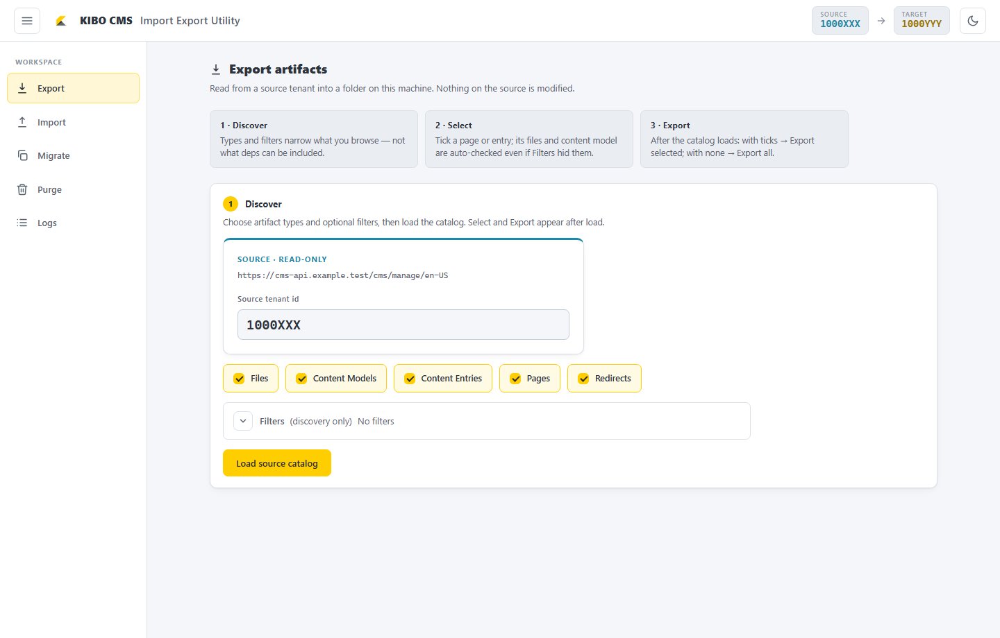
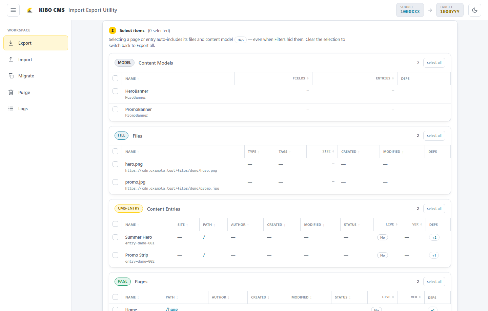
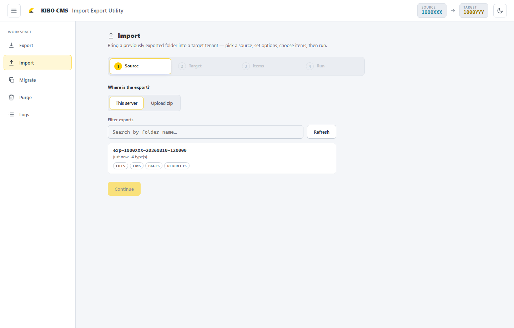
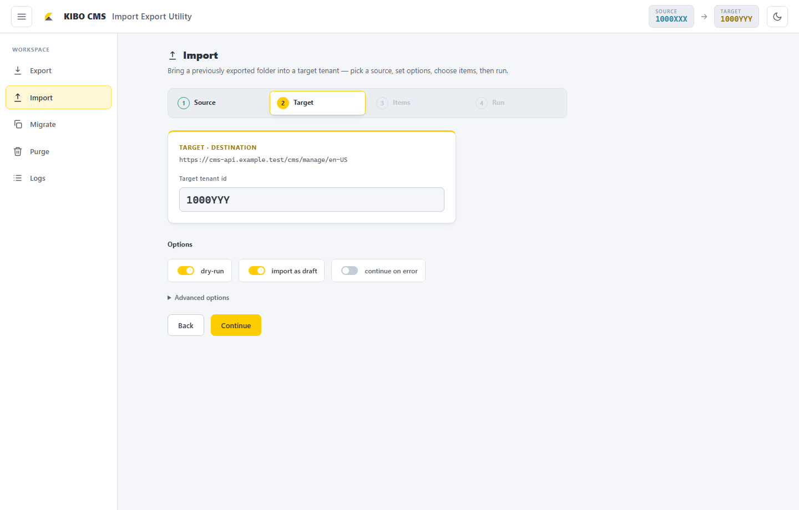
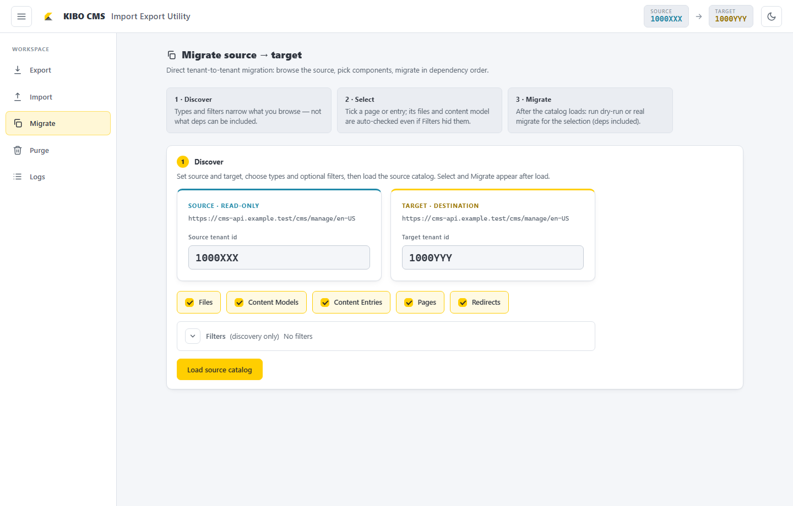
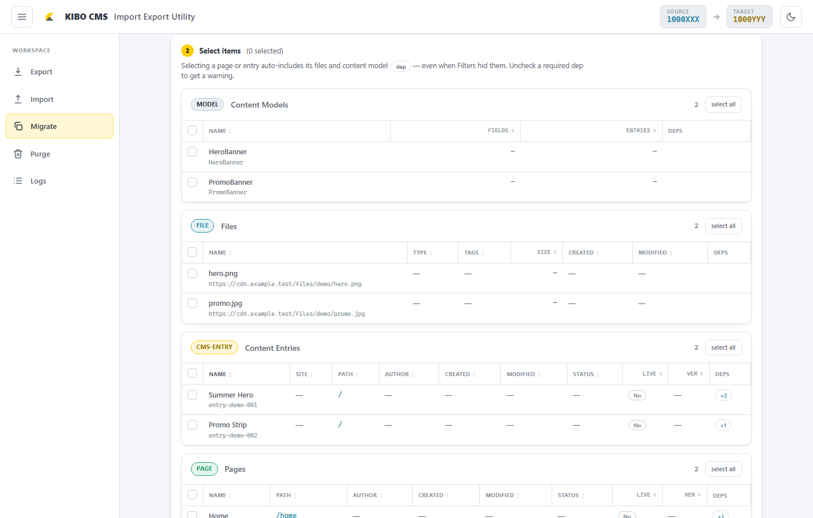
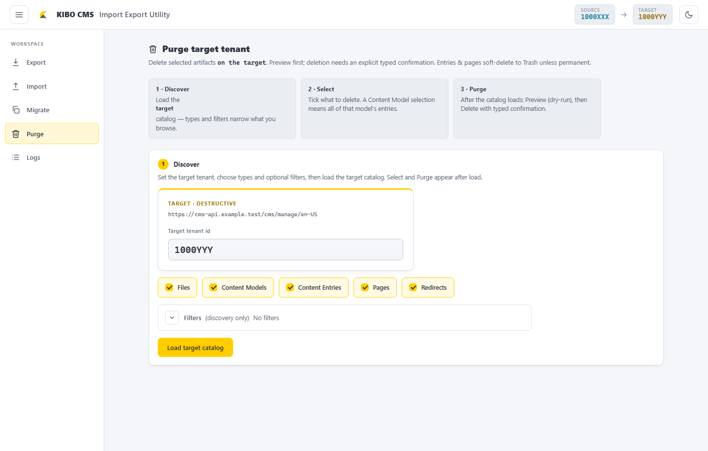
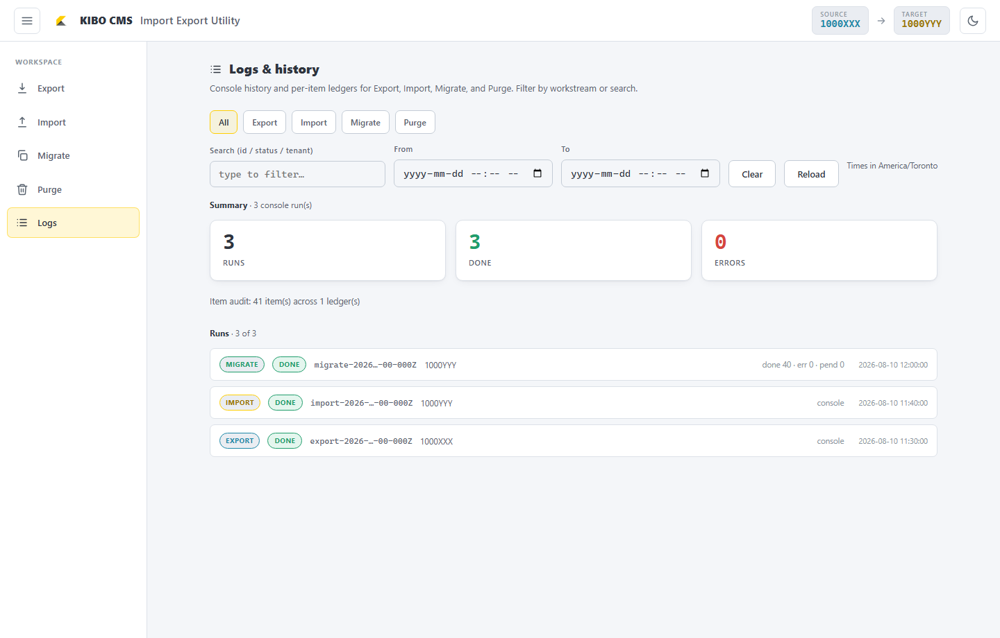

# Kibo CMS Migration Utility

A reference utility for copying Kibo CMS content between environments or tenants: **content models, Content Entries, pages, redirects, and files**. Binary file transfer streams from the source CDN to the target by default.

Operators may use the local **web UI** for interactive work, or the **CLI** for scripted and automated runs.

## ℹ️ Status and support

> This repository is provided **as-is** for professional use and evaluation. There is **no warranty**, and **no ongoing support, maintenance, or defect remediation** is offered by the authors or publisher.

> If the utility does not meet your requirements, **fork the repository** and adapt it for your organization. Contributions and forks are welcome; please do not expect fixes, SLAs, or implementation assistance from the original maintainers.

Review configuration, dry-run results, and target impact carefully before any live write. You are responsible for credentials, tenant selection, data integrity, and compliance in your environments.

---


| Capability               | Description                                                                                                           |
| ------------------------ | --------------------------------------------------------------------------------------------------------------------- |
| Live model provisioning  | Models are read from the source and created on the target — no manual schema export                                   |
| Schema and folder checks | Stops on field mismatches or folders that failed to sync (overridable when appropriate)                               |
| Selective or full copy   | Select items from a catalog and migrate, or export then import an entire environment                                  |
| Import as draft          | Entries and pages are imported as drafts by default; publishing can be enabled when the source revision was published |
| Resumable audits         | Per-item migrate ledger under `.logs/migrate/`; export/import/purge logs under `.logs/`                               |
| Live progress in the UI  | Each workspace streams a console while the job runs                                                                   |


The source environment is treated as **read-only**. The target is modified only when dry-run is disabled and a live run is executed.

---


## Quick start

**Prerequisites:** Node.js **20+**, git.

```bash
git clone <repo-url> CMSMigrationUtility
cd CMSMigrationUtility
npm install                   # also builds shared + links the local package
cp .env.example .env          # fill SOURCE_* and TARGET_* (see below)

# Start the UI (uses local ts-node and the shared package bootstrap)
npm run serve
# → http://localhost:4317
```

All commands in this README are intended to run from the **repository root**. A single root `.env` is used by the UI and the CLI. If `npm install` fails, resolve the install before starting the UI — `@kibo-cms-clone-tool/shared` is linked from `src/shared` during install.

Optional shortcut for shorter commands:

```bash
alias kibo='npm run cli --'
kibo serve
```

---


## Configure `.env`

Copy `.env.example` to `.env` and set source and target values. In the Kibo admin for each environment:


| Variable          | Where to get it                                                                |
| ----------------- | ------------------------------------------------------------------------------ |
| `*_ADMIN_GQL_URL` | GraphQL endpoint, e.g. `https://cms-api.<region>.gcp.kibocommerce.com/graphql` |
| `*_MANAGE_URL`    | Same host + `/cms/manage/<locale>`, e.g. `…/cms/manage/en-US`                  |
| `*_API_KEY`       | App key with **both** Admin GraphQL and Headless CMS (Manage) scopes           |
| `*_TENANT`        | The `/{tenantId}/` segment of the admin URL                                    |
| `*_CDN_DOMAIN`    | CDN host that serves file assets                                               |
| `LOCALE`          | e.g. `en-US` (shared; not prefixed with SOURCE_/TARGET_)                       |


Prefix each environment-specific variable with `SOURCE_` or `TARGET_`. See `.env.example` for URL shapes.

### API key permissions


| API               | Covers                             | If missing                                               |
| ----------------- | ---------------------------------- | -------------------------------------------------------- |
| **Admin GraphQL** | pages, redirects, files, folders   | those types cannot be read or written                    |
| **Manage API**    | content models and Content Entries | models/entries show **"Not authorized"** and are skipped |


A key with only Admin GraphQL is the usual cause of *"pages migrated but models/entries didn't."*

### Optional settings


| Variable                                                     | Default      | Effect                                                                                               |
| ------------------------------------------------------------ | ------------ | ---------------------------------------------------------------------------------------------------- |
| `CONCURRENCY`                                                | `5`          | Parallel writes on import                                                                            |
| `EXPORT_CONCURRENCY`                                         | `6`          | Parallel models on export/catalog (falls back to `CONCURRENCY`)                                      |
| `DRY_RUN`                                                    | `false`      | Default dry-run for CLIs that honor the flag                                                         |
| `RATE_LIMIT_DELAY_MS`                                        | `0`          | Minimum delay between GraphQL calls (ms)                                                             |
| `DEBUG`                                                      | `false`      | Verbose GraphQL logging                                                                              |
| `AS_DRAFT`                                                   | `true`       | Leave entries/pages as draft on import/migrate; set `false` to publish when the source was published |
| `MODELS`                                                     | —            | Limit Content Entries to these model names (comma-separated)                                         |
| `SITE_ID_FILTER`                                             | —            | Limit Content Entries to this `siteId`                                                               |
| `TAGS_FILTER`                                                | —            | Limit files to these tags (comma-separated)                                                          |
| `SCHEMA_FILE`                                                | —            | Offline content-model schema override (live fetch from source is the default)                        |
| `STRUCTURE_CHUNK_SIZE`                                       | `1`          | Models per structure-import call; keep small if you see gateway **504** timeouts                     |
| `STRUCTURE_TIMEOUT_MS`                                       | `35000`      | Abort a hung structure-import call (ms)                                                              |
| `INCLUDE_UNPUBLISHED`                                        | `true`       | Include unpublished pages on export                                                                  |
| `SKIP_EXISTING`                                              | `true`       | Skip files that already exist on the target                                                          |
| `MAX_FILE_SIZE_MB`                                           | *(none)*     | Skip binaries larger than this size (MB)                                                             |
| `SOURCE_S3_BUCKET` / `TARGET_S3_BUCKET` / `SOURCE_S3_PREFIX` | placeholders | Names used only in `s3-copy-manifest.txt` (not for live streaming)                                   |


See `.env.example` for the full annotated list.

---


## Web UI

```bash
npm run cli -- serve          # http://localhost:4317
npm run cli -- serve --port 4400
```

Five workspaces are available. Each job returns immediately and **streams a live console** while it runs. Logs are also written under `.logs/{export,import,migrate,purge}/`.


| Workspace   | Purpose                                                                                    |
| ----------- | ------------------------------------------------------------------------------------------ |
| **Export**  | Export selected content types from a **source** tenant into a dated folder under `export/` |
| **Import**  | Import a saved (or uploaded zip) export folder into a **target** tenant                    |
| **Migrate** | Select items from a live catalog and copy source → target in one flow                      |
| **Purge**   | Delete selected items **on the target** (preview first, typed confirmation)                |
| **Logs**    | Review migrate ledgers, job consoles, and summary metrics                                  |

### UI walkthrough

Screenshots below use **mock** tenant ids (`1000XXX` → `1000YYY`) and `cms-api.example.test` URLs for illustration only. Substitute your real source and target values from `.env`.

#### Shell

After `npm run serve`, open `http://localhost:4317`. The left **Workspace** nav switches Export / Import / Migrate / Purge / Logs. The header shows the current source and target tenant ids loaded from `.env` (editable per workspace where a tenant field is shown).

#### Export

1. Open **Export**. Confirm the **source tenant id** and artifact chips (Files, Content Models, Content Entries, Pages, Redirects).
2. Optionally open **Filters** for discovery-only narrowing, then click **Load source catalog**.
3. In **Select items**, check pages or entries as needed. File and model dependencies are auto-included as `dep` rows.
4. With a selection: use **Export selected**. With no selection after load: use **Export all**. Prefer dry-run on later Import/Migrate steps before live writes.





#### Import

1. Open **Import** → step **Source**. Choose a server export folder (for example `exp-1000XXX-…`) or **Upload zip**.
2. Continue to **Target**. Set the **target tenant id**, leave **dry-run** on for a preview, then proceed through **Items** and **Run**.





#### Migrate

1. Open **Migrate**. Set **source** and **target** tenant ids, choose artifact types (and optional filters), then **Load source catalog**.
2. Select items (dependencies hydrate the same way as Export). Keep **dry-run** on for the first pass, then disable it for a live copy.





#### Purge

Open **Purge**, set the **target** tenant id, load a target catalog, preview with dry-run, then confirm deletion by typing the target tenant id. Purge is destructive — use with care.



#### Logs

Open **Logs** to review prior export / import / migrate / purge runs, consoles, and summary metrics.



### Common options

#### Export


| Option                                   | Default                                            | Meaning                                                                                                                          |
| ---------------------------------------- | -------------------------------------------------- | -------------------------------------------------------------------------------------------------------------------------------- |
| **Load source catalog**                  | —                                                  | Browse items (same type chips / filters as discovery). Selecting a page/entry **hydrates** file/model deps as checked `dep` rows |
| **Export selected**                      | after catalog load, when items are checked         | Hydrates deps and exports **only that closure** into `export/exp-<tenant>-<ts>/`                                                 |
| **Export all**                           | after catalog load; hidden while items are checked | Whole-type `export-all` for the selected chips (filters apply as today)                                                          |
| **continue on error**                    | on                                                 | If one content type fails, keep exporting the rest                                                                               |
| **include binaries**                     | off                                                | Also download file bytes into the export folder (File Manager only)                                                              |
| **max MB**                               | 0 = all                                            | Skip binaries larger than this size                                                                                              |
| **Content Models** / **Content Entries** | separate chips                                     | Export models, entries, or both                                                                                                  |
| **Filters**                              | off                                                | Discovery for catalog load / whole-type export. Deps still included when using **Export selected**                               |


CLI: `export-selected --catalog catalog.json --select @ids.txt --out ./export/exp-…` (optional `--omit-deps`, `--allow-missing-deps`).

#### Import


| Option                | Default | Meaning                                                                                                                                                                                                                                                                                                     |
| --------------------- | ------- | ----------------------------------------------------------------------------------------------------------------------------------------------------------------------------------------------------------------------------------------------------------------------------------------------------------- |
| **dry-run**           | on      | Preview the import plan with **no writes** to the target                                                                                                                                                                                                                                                    |
| **import as draft**   | on      | Leave entries and pages as drafts. Turn off to publish when the source was published                                                                                                                                                                                                                        |
| **continue on error** | off     | If one content type fails, keep importing the rest                                                                                                                                                                                                                                                          |
| **Item selection**    | none    | Select none = import everything. Select models only = schemas. Select rows = those items **and deps present in the export folder** (auto-checked `dep` rows; omit modal + `omittedDepIds` same as Migrate). No live hydrate — re-export with **Export selected** if a file/model is missing from the folder |


**Advanced options** (collapsed by default):


| Option                            | Default | Meaning                                                                                                                                                      |
| --------------------------------- | ------- | ------------------------------------------------------------------------------------------------------------------------------------------------------------ |
| **allow folder mismatch**         | off     | If a folder could not be recreated, place affected items in **root** instead of failing                                                                      |
| **allow schema mismatch**         | off     | Continue when target model fields differ from source (mismatched fields may still fail). Missing models are still created. Existing models are never changed |
| **upload binaries (from folder)** | off     | Force offline use of the export’s `files/binaries/` cache (gaps are skipped). File Manager only. When a cache is present, import already prefers it without this toggle |
| **Manifest only**                 | off     | Do **not** transfer file bytes — write `s3-copy-manifest.txt` for manual copy. When off and no local cache exists, binaries stream source CDN → target S3   |
| **max MB**                        | 0 = all | Size gate for file binaries                                                                                                                                  |


#### Migrate


| Option                | Default | Meaning                                                                                                                                                                                                                                                                                                                                   |
| --------------------- | ------- | ----------------------------------------------------------------------------------------------------------------------------------------------------------------------------------------------------------------------------------------------------------------------------------------------------------------------------------------- |
| **Type chips**        | all on  | Catalog only the selected content types                                                                                                                                                                                                                                                                                                   |
| **Filters**           | off     | **Discovery only** — narrow what you browse and pick. Per selected type: turn **Filter** on for date/name/tags (or model names). **Load / Reload** re-fetches; **Narrow** filters in the browser. Selecting a page/entry still **hydrates** its file/model deps even if those rows were filtered out (they appear as checked `dep` rows). |
| **dry-run**           | on      | Resolve the plan and dependencies with **no writes** and no ledger                                                                                                                                                                                                                                                                        |
| **import as draft**   | on      | Same as Import — drafts by default; turn off to publish when the source was published                                                                                                                                                                                                                                                     |
| **continue on error** | off     | Keep going after a failure (you can resume later from the CLI)                                                                                                                                                                                                                                                                            |


**Advanced options** (collapsed by default):


| Option                                                | Default | Meaning                                                                                      |
| ----------------------------------------------------- | ------- | -------------------------------------------------------------------------------------------- |
| **skip-export (reuse last export)**                   | off     | Reuse the staging export folder. Leave **off** unless you just exported this exact selection |
| **allow schema mismatch** / **allow folder mismatch** | off     | Same meaning as Import                                                                       |
| **max MB**                                            | 0 = all | Size gate for file binaries                                                                  |


#### Purge


| Option                       | Default | Meaning                                                                                                                                                               |
| ---------------------------- | ------- | --------------------------------------------------------------------------------------------------------------------------------------------------------------------- |
| **Type chips** / **Filters** | —       | Load a catalog from the **target**; per selected type turn **Filter** on to set that type's date/name/tags (or model names). Types with Filter off are unconstrained. |
| **permanent (hard delete)**  | off     | Skip the recycle bin — **unrecoverable**. Off = soft delete                                                                                                           |
| **allow same tenant**        | off     | Required if source and target tenants are the same                                                                                                                    |
| **Preview (dry-run)**        | —       | Shows what would be deleted; writes nothing                                                                                                                           |
| **Delete selected…**         | —       | You must **type the target tenant id** to confirm                                                                                                                     |

Purging a **Content Model** deletes **all entries** for that model on the target. File purge removes File Manager **metadata only** — S3 objects are never deleted by this tool.


---


## CLI

Two main flows:

1. **Selective** — catalog → plan → migrate (best when you know what to copy)
2. **Whole environment** — export-all → review → import-all


### Selective copy

```bash
# 1. Catalog source (or target)
npm run cli -- catalog-all --env source --out catalog.json
npm run cli -- catalog-all --env target --out target-catalog.json

# 2. Plan (optional — migrate also resolves dependencies)
npm run cli -- plan --catalog catalog.json --select @ids.txt --out plan.json

# 3. Migrate — always dry-run first
npm run cli -- migrate --catalog catalog.json --select @ids.txt --dry-run
npm run cli -- migrate --catalog catalog.json --select @ids.txt

# Common overrides
npm run cli -- migrate --catalog catalog.json --select @ids.txt --allow-schema-mismatch
npm run cli -- migrate --catalog catalog.json --select @ids.txt --allow-folder-mismatch
npm run cli -- migrate --catalog catalog.json --select @ids.txt --allow-missing-deps
npm run cli -- migrate --catalog catalog.json --select @ids.txt --no-as-draft
npm run cli -- migrate --catalog catalog.json --select @ids.txt --continue-on-error

# 4. Audit / resume
npm run cli -- runs
npm run cli -- runs --show <run-id>
npm run cli -- metrics
npm run cli -- migrate --resume <run-id>
```

Migrate order: **models → files → entries → pages → redirects**. Before export, migrate **hydrates** missing file/model deps from source (outside the catalog filter window); unresolved deps fail the run unless `--allow-missing-deps`. File export is selective (`--select`) so only folders for those files sync. Ledgers live at `.logs/migrate/<runId>/ledger.json`. Dry-run records **no** ledger. (Whole-environment `import-all` uses a different order: **files → models/entries → pages → redirects**.)

Override tenants for one command:

```bash
SOURCE_TENANT=<src> TARGET_TENANT=<tgt> npm run cli -- migrate --catalog catalog.json --select @ids.txt
```


### Filters

Export and catalog accept a JSON filter file for dates, names, and tags:

```bash
npm run cli -- export-all --filter ./filter.json --out ./export
npm run cli -- catalog-all --filter ./filter.json --out catalog.json
```

Example `filter.json`:

```json
{
  "timezone": "America/New_York",
  "date": { "field": "createdOn", "mode": "relative", "preset": "last_7d" },
  "fields": [
    { "artifact": "cms-entry", "field": "name", "op": "contains", "value": ["hero", "banner"] },
    { "artifact": "page", "field": "name", "op": "contains", "value": "/checkout" },
    { "artifact": "file", "field": "tags", "op": "in", "value": ["hero"] }
  ]
}
```


### Whole-environment copy

```bash
# Export → ./export/{files,cms,pages,redirects}
npm run cli -- export-all --out ./export
npm run cli -- export-all --out ./export --with-binaries
npm run cli -- export-all --out ./export --skip file-manager,redirects
npm run cli -- export-all --out ./export --continue-on-error

# Import (dry-run first)
npm run cli -- import-all --in ./export --dry-run
npm run cli -- import-all --in ./export
npm run cli -- import-all --in ./export --no-as-draft
npm run cli -- import-all --in ./export --allow-schema-mismatch --allow-folder-mismatch
npm run cli -- import-all --in ./export --manifest-only
npm run cli -- import-all --in ./export --select @ids.txt
```

Paths are resolved from the repository root.

### Purge (destructive)

```bash
npm run cli -- catalog-all --env target --out target-catalog.json

# Preview (default — omit --force)
npm run cli -- purge --catalog target-catalog.json --select @ids.txt

# Delete for real
npm run cli -- purge --catalog target-catalog.json --select @ids.txt --force
npm run cli -- purge --catalog target-catalog.json --select @ids.txt --force --permanent
```


| Flag                  | Effect                                                 |
| --------------------- | ------------------------------------------------------ |
| *(omit* `--force`*)*  | **Dry-run** — preview only                             |
| `--force`             | Actually delete                                        |
| `--permanent`         | Hard delete (skip recycle bin). Default is soft delete |
| `--allow-same-tenant` | Required when target tenant equals source              |


File purge removes File Manager **metadata only**. S3 binary objects are never deleted by this tool (there is no UI or CLI flag to remove them).

---


## Tests

```bash
npm test                 # unit (vitest)
npm run test:plan        # unit + Playwright smoke + hydrate UI (same as CI)
npm run test:e2e         # full Playwright suite (live specs need a real .env; smoke/hydrate specs mock CMS)
```

CI (`.github/workflows/ci.yml`) runs `npm run test:plan` on push to `main`/`master` and on all pull requests.

---


## Operational notes

- **Defaults favor preview** — dry-run and import-as-draft checkboxes are on in the UI until explicitly disabled. Those toggles do **not** read `DRY_RUN` / `AS_DRAFT` from `.env` (env defaults apply to the CLI).
- **Filter JSON shape** — the web UI emits per-artifact `dates` when Filter is on for a type; CLI `--filter` files may still use a single top-level `date` (the engine accepts both).
- **Idempotent imports** — re-running the same selection upserts by stable keys (entry id, page path, redirect from, file key).
- **Models are create-only** — missing models are created from the source; existing models are validated and never auto-changed.
- **File binaries** — with no local cache, import/migrate stream source CDN → target by default. If the export includes `files/binaries/manifest.json`, import prefers that cache (gaps can still stream). Use **Manifest only** / `--manifest-only` when byte transfer is unavailable and a manual copy list is required.
- **Logs** — workstream output under `.logs/{export,import,migrate,purge}/<runId>/`; migrate item ledger at `.logs/migrate/<runId>/ledger.json`.

